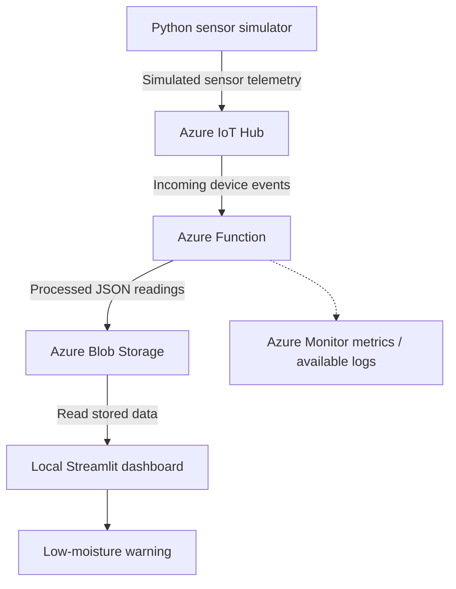
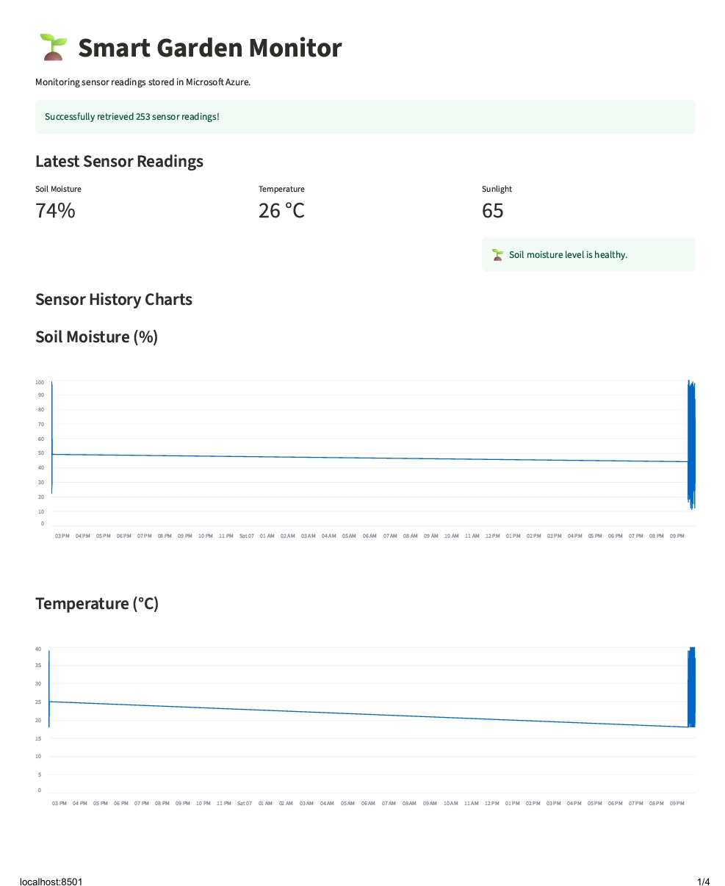
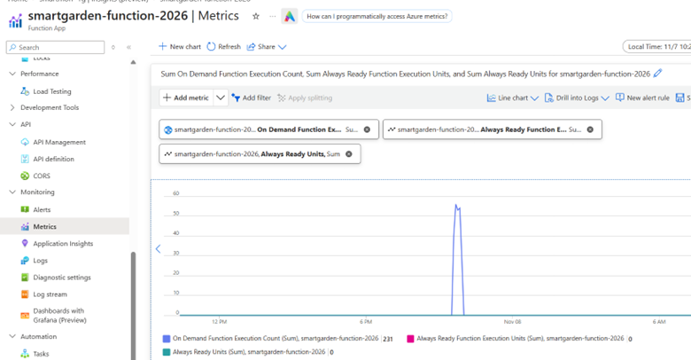
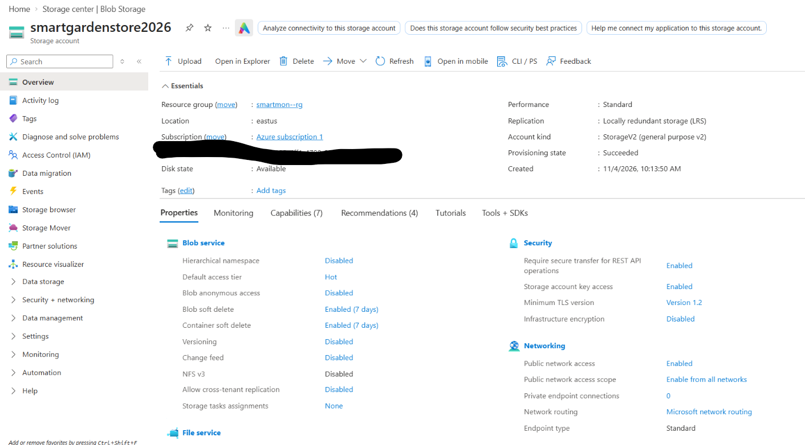
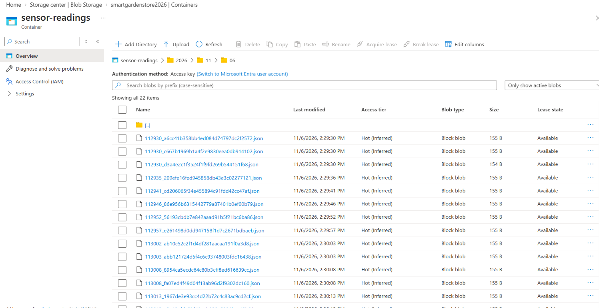
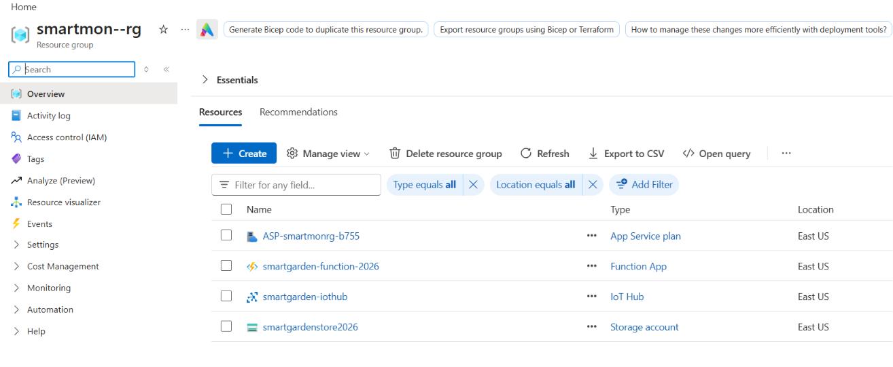
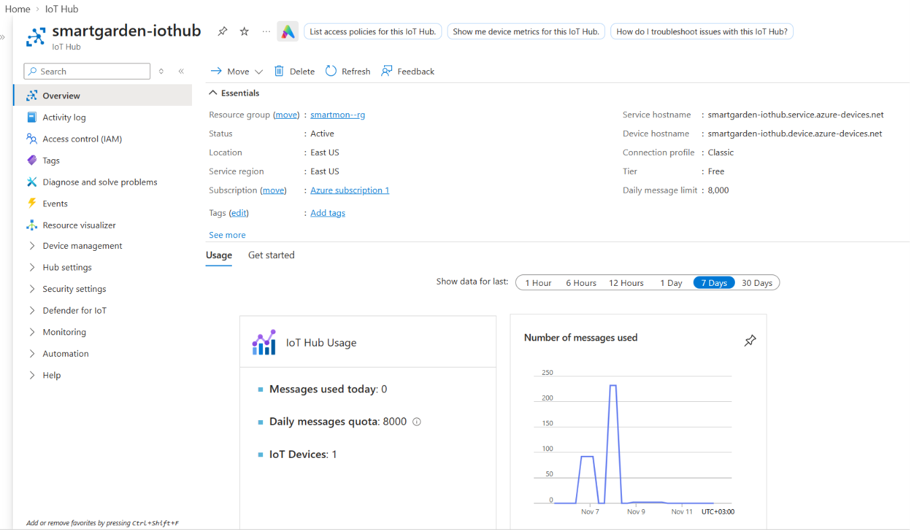
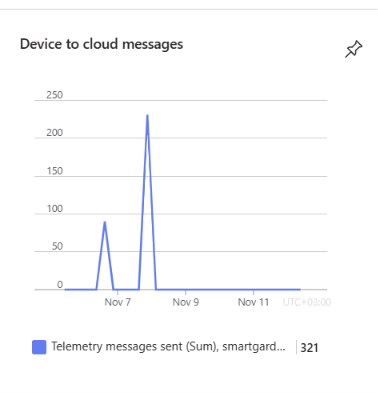

# Smart Garden Monitor

A beginner-level Python and Microsoft Azure IoT learning project. The project simulates garden sensor readings, sends telemetry to Azure IoT Hub, processes incoming events with Azure Functions, stores readings in Azure Blob Storage, and displays the stored data in a local Streamlit dashboard.

> **Project status:** Learning and portfolio prototype. Sensor values are simulated; physical sensors are not used in the current implementation. This project demonstrates a basic cloud-data pipeline and is not a production or enterprise deployment.

## Table of contents

1. [Project overview](#1-project-overview)
2. [Architecture and data pipeline](#2-architecture-and-data-pipeline)
3. [Why each component is used](#3-why-each-component-is-used)
4. [Azure resources](#4-azure-resources)
5. [Repository structure](#5-repository-structure)
6. [Screenshots and project evidence](#6-screenshots-and-project-evidence)
7. [Prerequisites](#7-prerequisites)
8. [Local configuration](#8-local-configuration)
9. [Install and run](#9-install-and-run)
10. [Verify the pipeline](#10-verify-the-pipeline)
11. [Monitoring and known limitations](#11-monitoring-and-known-limitations)
12. [Security checklist](#12-security-checklist)
13. [Troubleshooting](#13-troubleshooting)
14. [What is implemented and what could be added later](#14-what-is-implemented-and-what-could-be-added-later)
15. [Learning outcomes](#15-learning-outcomes)
16. [Portfolio summary](#16-portfolio-summary)

---

## 1. Project overview

The Smart Garden Monitor demonstrates how a simple IoT-style solution can send data to the cloud and make that data available for viewing.

The Python simulator generates example readings for:

- Soil moisture
- Temperature
- Sunlight

The readings travel through Azure services and are saved as JSON data. A local Streamlit dashboard reads the stored data and displays the latest values, charts and reading history. The dashboard also includes a basic low-soil-moisture warning.

The project was built to gain introductory, practical experience with Python, Azure services, cloud data flow and troubleshooting.

## 2. Architecture and data pipeline

The project follows this sequence:




### Pipeline explained

1. **Generate data — Python simulator:** `sensor_simulator.py` creates example soil-moisture, temperature and sunlight readings, together with device and timestamp information.
2. **Receive data — Azure IoT Hub:** The registered device sends its telemetry to the IoT Hub.
3. **Process data — Azure Functions:** An event-triggered Function receives messages, reads the JSON data and checks required fields before storing the reading.
4. **Store data — Azure Blob Storage:** The Function saves readings as JSON blobs in the `sensor-readings` container.
5. **Display data — Streamlit:** `dashboard.py` reads the stored blobs and displays the latest measurements, charts and reading history.
6. **Observe activity — Azure metrics and logs:** Available Function metrics provide evidence of execution activity. A dashboard threshold provides a simple low-moisture warning.

## 3. Why each component is used

| Component | Responsibility in this project | Why it is used |
|---|---|---|
| Python simulator | Generates soil-moisture, temperature and sunlight readings | Allows the pipeline to be tested without physical sensors |
| Azure IoT Hub | Receives telemetry from the registered device | Provides a managed entry point for device messages |
| Azure Functions | Receives and processes incoming events | Separates processing from the simulator and dashboard |
| Azure Blob Storage | Stores processed readings as JSON blobs | Keeps readings available for later retrieval and visualisation |
| Streamlit | Displays latest readings, charts and history | Provides a simple local dashboard |
| Azure Monitor metrics / available Function logs | Shows available execution activity and supports basic investigation | Helps identify whether the Function App is being invoked |

## 4. Azure resources

The project used the following Azure resource names:

| Resource | Name | Purpose |
|---|---|---|
| Resource group | `smartmon--rg` | Groups the project resources |
| IoT Hub | `smartgarden-iothub` | Receives device telemetry |
| IoT Hub device identity | `gardensensor1` | Identifies the simulator as a device |
| Function App | `smartgarden-function-2026` | Runs event-driven processing |
| Storage account | `smartgardenstore2026` | Stores sensor readings |
| Blob container | `sensor-readings` | Holds the JSON reading files |

These are the names used in this learning project. Before sharing screenshots publicly, check that they do not reveal subscription IDs, tenant IDs, account details or credentials.

## 5. Repository structure

The repository separates the Python application, Azure Function code, configuration examples and project evidence.

```text
Smartgarden-project/
│
├── README.md
├── dashboard.py
├── sensor_simulator.py
├── requirements.txt
├── .env.example
├── .gitignore
│
├── function_app/
│   ├── function_app.py
│   ├── host.json
│   ├── requirements.txt
│   ├── .funcignore
│   └── .gitignore
│
└── docs/
    └── images/
        ├── streamlit-dashboard.png
        ├── azure-function-metrics.png
        ├── azure-storage-account.png
        ├── blob-container.png
        ├── azure-resource-group.png
        ├── azure-iot-hub-overview.png
        └── iot-device-telemetry.png
```

**Security note:** The actual `.env` file, Python virtual environments and `function_app/local.settings.json` are excluded from the public repository. The `.env.example` file contains placeholder values only.

## 6. Screenshots and project evidence

The following screenshots provide visual evidence of the Smart Garden Monitor learning project, including the local dashboard, Azure resources, Function execution activity and IoT Hub telemetry.

### 6.1 Streamlit dashboard

The dashboard reads stored sensor data from Azure Blob Storage and presents the latest measurements, historical charts and a low-moisture status message.



### 6.2 Azure Function execution metrics

The available Azure Metrics view showed On Demand Function Execution Count. This is evidence that the Function App was invoked during the selected period. Execution count alone does not prove that every invocation completed successfully or that every reading was stored.



### 6.3 Azure Storage account

The Storage account is used to persist the processed readings. The project screenshots showed the account configuration, including Standard performance and locally redundant storage (LRS).



### 6.4 Blob container

The `sensor-readings` container is the destination for the JSON readings written by the Function. The screenshot shows stored JSON reading files.



### 6.5 Azure resource group

The resource group provides a single place to view the Azure resources used by the project.



### 6.6 Azure IoT Hub overview

The IoT Hub overview shows the active Hub, its registered device count and message usage information.



### 6.7 Device-to-cloud telemetry

The telemetry metrics provide evidence of messages sent from the simulated device to Azure IoT Hub. The captured screenshot shows 321 telemetry messages sent.



## 7. Prerequisites

To run or reproduce this project, you need:

- Python installed on your computer.
- Visual Studio Code or another Python editor.
- An Azure subscription.
- An Azure IoT Hub with a device identity.
- An Azure Function App configured with the appropriate IoT Hub / Event Hubs-compatible event trigger.
- An Azure Storage account and a blob container named `sensor-readings`.
- The Python packages listed in the root and Function App `requirements.txt` files.

The Azure resources must be configured before the end-to-end cloud pipeline can work. The local dashboard also needs valid access to the Storage account.

## 8. Local configuration

Create a local file named `.env` in the project root. This file stores local configuration and must not be committed to GitHub.

The simulator and dashboard use **different credentials**:

- The simulator uses an IoT Hub device connection string.
- The dashboard uses an Azure Storage connection string.


# Used by dashboard.py to read Blob Storage.
AZURE_STORAGE_CONNECTION_STRING=
AZURE_STORAGE_CONTAINER=sensor-readings
```

**Important:** Check the actual environment-variable names in your Python files. If your simulator uses a different name, use that exact name in `.env` and in `.env.example`. Do not assume the example name matches your source code.

If the Python files use `python-dotenv`, load the `.env` file before reading environment variables. For example:

```python
from dotenv import load_dotenv

load_dotenv()
```

Do not print or share the contents of `.env`. Never use the Storage connection string as the IoT Hub device connection string, or vice versa.

## 9. Install and run

Open PowerShell in the project root folder.

### 9.1 Create and activate a virtual environment

```powershell
python -m venv .venv
.\.venv\Scripts\Activate.ps1
```

### 9.2 Install root project dependencies

```powershell
python -m pip install --upgrade pip
python -m pip install -r requirements.txt
```

If the Function App has a separate requirements file and you are setting up its Python environment, install those dependencies in the environment used for the Function App:

```powershell
python -m pip install -r .\function_app\requirements.txt
```

### 9.3 Start the sensor simulator

Open a first terminal in the project root, activate the virtual environment, and run:

```powershell
python sensor_simulator.py
```

Check that the simulator connects and sends readings. The simulator may stop if its code is configured for a finite number of readings; check the script if you expect it to continue running.

### 9.4 Start the Streamlit dashboard

Open a second terminal in the project root, activate the virtual environment, and run:

```powershell
streamlit run dashboard.py
```

The dashboard should retrieve readings from the configured Blob Storage container and display the latest values and history. For the dashboard to show new data, the simulator and cloud processing pipeline must be running and new blobs must be arriving. Automatic dashboard refresh depends on the refresh code being enabled.

## 10. Verify the pipeline

Check each stage in order. This helps identify where data stops moving.

1. **Simulator:** Is `sensor_simulator.py` generating and sending telemetry?
2. **IoT Hub:** Is the device registered, and is message ingestion activity increasing?
3. **Azure Function:** Is the event-triggered Function being invoked? Review the available metrics and logs.
4. **Blob Storage:** Are new JSON blobs appearing in the `sensor-readings` container?
5. **Dashboard:** Does Streamlit retrieve the stored readings and display them in the charts and table?

A Function execution count indicates invocation activity. It does not, by itself, prove that each event passed validation or was successfully written to Blob Storage. Check the next stage of the pipeline as well.

## 11. Monitoring and known limitations

The Azure Metrics screenshot available during this project showed **On Demand Function Execution Count**. The Always Ready metrics shown in the portal had zero values. Those Always Ready metrics are not required to demonstrate this consumption-based learning prototype.

The Function App screenshots showed an Application Insights configuration prompt. The Log stream page also prompted for Application Insights configuration. Therefore, this project does **not** claim that Application Insights dependency tracing, detailed failure analytics or tested alert rules are configured.

The Storage lifecycle-management screenshot showed **No rules**. This means a lifecycle retention or tiering policy was not configured in the view captured for this project.

Application Insights, Log Analytics and diagnostic ingestion can incur costs. Review the relevant Azure pricing, retention and monitoring requirements before enabling them.

## 12. Security checklist

- Keep `.env` out of Git.
- Keep secret-bearing `local.settings.json` out of Git.
- Never publish IoT Hub device keys, Storage connection strings, SAS tokens, passwords or certificates.
- Use `.env.example` only for blank placeholders.
- Review screenshots for subscription IDs, tenant IDs, account details and unmasked keys.
- If a secret was committed, rotate or revoke it in Azure. Removing it in a later commit does not make an exposed credential safe.
- Use least-privilege access for Azure resources.

Before the first GitHub upload, review the files shown by `git status` and make sure no secret-bearing file is staged.

## 13. Troubleshooting

The most useful approach is to investigate the pipeline in order. Find the first stage where expected evidence is missing, then check that stage and the connection to the next stage.

| Symptom | Likely reason / first checks |
|---|---|
| Simulator says the IoT connection string is missing | Check the environment-variable name used by `sensor_simulator.py`. Confirm the project-root `.env` is loaded before `os.getenv()` is called. |
| `UnauthorizedError` or invalid connection-string key | Check that the connection string belongs to the IoT Hub device `gardensensor1`. Make sure it is not the Storage connection string. Keep the value private. |
| `ModuleNotFoundError: No module named 'azure'` | Activate the correct virtual environment and install the project requirements using `python -m pip`. |
| Function does not trigger | Check simulator output, IoT Hub ingestion, Function App status, trigger configuration and consumer-group settings. |
| Function runs but no blob appears | Review available Function logs, Storage configuration, container name and write permissions. |
| Dashboard shows old readings | Check whether the simulator is running and whether new blobs are being created. Then check dashboard refresh and caching behaviour. |
| Log stream asks for Application Insights | This is a configuration prompt. It does not, by itself, mean that the Function is broken. |
| Only Function Execution Count is available | Record the metric that is available. Do not claim unavailable dependency or failure metrics. |
| Lifecycle management says “No rules” | No lifecycle policy is configured in that view. Define retention requirements before creating a rule. |

For a more detailed explanation of the errors encountered during development, refer to the separate project documentation in `docs/`.

## 14. What is implemented and what could be added later

This project is intentionally limited in scope. It demonstrates a basic working cloud-data pipeline rather than a fully secured, highly available enterprise IoT platform.

### Demonstrated in this learning prototype

- Simulated sensor readings generated with Python.
- An IoT Hub device identity.
- Event-driven Azure Function processing.
- JSON persistence in Azure Blob Storage.
- A local Streamlit dashboard with latest readings, history and a low-moisture threshold warning.
- Azure Function execution-count metric evidence.
- Basic investigation of connection, configuration and runtime errors.

### Possible future improvements — not claimed as implemented

- Connect physical sensors and explore device-fleet provisioning.
- Use managed identity where supported, reducing reliance on connection strings.
- Store and manage secrets using Azure Key Vault.
- Consider private endpoints and network restrictions.
- Configure Application Insights / Log Analytics, dependency telemetry and tested alert rules.
- Define and test Storage lifecycle and retention policies.
- Add automated tests, CI/CD and infrastructure as code.
- Add production incident acknowledgement, escalation and audit processes.

These are possible next steps for a more advanced implementation. They should not be interpreted as features already configured in this project.

## 15. Learning outcomes

This project was completed as a beginner-level practical exercise in Python, cloud services and event-driven processing.

Through the project, I gained introductory hands-on exposure to:

- Writing and running a basic Python sensor simulator.
- Using Python virtual environments and installing packages.
- Working with environment variables and `.env` configuration.
- Registering and using an Azure IoT Hub device identity.
- Understanding how Azure IoT Hub receives device telemetry.
- Using an Azure Function to process incoming events.
- Storing and retrieving JSON data in Azure Blob Storage.
- Using Streamlit and Pandas for basic data visualisation.
- Reviewing available Azure Function execution metrics.
- Investigating connection-string, configuration and runtime errors.
- Keeping credentials out of source control and public screenshots.

The project helped me understand how separate cloud services can work together in a simple end-to-end solution. I am continuing to develop my practical knowledge of Azure administration, Python and cloud operations.

## 16. Portfolio summary

Built a beginner-level Python and Microsoft Azure Smart Garden Monitor prototype. Generated simulated soil-moisture, temperature and sunlight readings; sent device telemetry to Azure IoT Hub; processed incoming events with Azure Functions; stored readings as JSON blobs in Azure Blob Storage; and created a local Streamlit dashboard to display current values, historical charts and a basic low-moisture warning. Practised configuring the development environment, troubleshooting service connections and reviewing available Azure execution metrics.

> **Important:** This project uses simulated sensor data and is intended for learning and portfolio demonstration. It is not a production deployment. My experience with Python and the Azure services in this project is beginner-level and based on personal hands-on learning.

- Managed identity replacing connection-string authentication end to end.
- Key Vault integration.
- Private endpoints and network isolation.
- Application Insights dependency tracing and tested alert rules.
- Formal retention/lifecycle rules.
- CI/CD, infrastructure as code, staging approvals and rollback.
- Production incident acknowledgement, escalation and audit workflows.

12. Portfolio summary
Built a Python-based Smart Garden Monitor prototype using Microsoft Azure IoT Hub, Azure Functions, Azure Blob Storage and Streamlit. Simulated soil-moisture, temperature and sunlight telemetry; sent device messages to IoT Hub; processed events with an Azure Function; stored JSON readings in Blob Storage; and built a local dashboard with current readings, historical charts and a low-moisture warning. Documented the end-to-end pipeline, Azure monitoring evidence, security considerations and troubleshooting.
Important: This project uses simulated sensor data and is intended for learning and portfolio demonstration.
